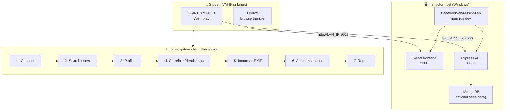

# FLOWSINT — Step-by-Step Flow for the Classroom OSINT Lab

> **CYBERSECURITY CLASSROOM SIMULATION — ALL PEOPLE, POSTS, COMPANIES, PROJECTS, AND EVENTS ARE FICTIONAL.**
> This lab targets only a fictional Facebook-style app on an instructor-authorized
> network. It is not connected to Facebook/Meta, real people, or real systems.

This is the simplified "big picture" flow that connects the two project repos and
turns them into a single teachable exercise:

- **Target (instructor side):** [`Facebook-and-Osint-Lab`](https://github.com/Tsuyoiman/Facebook-and-Osint-Lab)
  — a fictional Facebook clone (React + Express + MongoDB) run on a Windows host.
- **Investigation client (student side):** [`OSINTPROJECT`](https://github.com/Tsuyoiman/OSINTPROJECT)
  — a Python OSINT tool run on a Kali Linux VM.

For full detail and troubleshooting, keep each repo's own README open. This document
is the map; the READMEs are the territory.

---

## 0. The whole flow at a glance



**One sentence:** the instructor runs the fictional site on Windows; each student
points Kali at it, then walks a clue from *name → username → profile → network of
relationships → images → authorized scan → written report.*

---

## 1. Prerequisites (one-time)

| Instructor host (Windows) | Student VM (Kali Linux) |
|---|---|
| Node.js + npm installed | VMware/VirtualBox with a Kali VM |
| `Facebook-and-Osint-Lab` cloned | Python 3 + `git` |
| On the authorized classroom LAN | Able to reach the Windows host over the LAN |

Decide the **network path** between the two before class:

- **Bridged** — Kali and Windows get addresses on the same physical LAN (simplest).
- **Host-only** — isolated instructor↔VM network.
- **NAT** — needs VMware port forwarding to the Windows host.

> ⚠️ Keep the lab on a private classroom network. Never expose it to the public internet.

---

## 2. Instructor setup — start the target (do this first)

Run on the **Windows host**:

```powershell
cd C:\path\to\Facebook-and-Osint-Lab
npm run install:all     # first time only (may download MongoDB — can take minutes)
npm run dev             # starts frontend + backend + local MongoDB together
```

The terminal prints the addresses students need. Example:

```text
on this machine:  http://localhost:3001
on Wi-Fi:         http://10.3.3.171:3001     <-- frontend (browser)
api:              http://10.3.3.171:8000     <-- API (OSINT client)
```

Then:

1. **Write the LAN IP and both ports on the board.** Ports change if `3001`/`8000`
   are busy — always use what the terminal actually printed.
2. **Keep the PowerShell window open** the whole class.
3. **Allow the ports through Windows Firewall** (PowerShell as Administrator, private
   network only):
   ```powershell
   New-NetFirewallRule -DisplayName "Lab Frontend" -Direction Inbound -Action Allow -Protocol TCP -LocalPort 3001 -Profile Private
   New-NetFirewallRule -DisplayName "Lab API"      -Direction Inbound -Action Allow -Protocol TCP -LocalPort 8000 -Profile Private
   ```
4. **Seeded accounts** use the password `C1sc0123`. Students can also register new
   fictional accounts — they appear in search too.

✅ **Checkpoint:** open the printed *on this machine* URL in the Windows browser and
confirm the site loads.

---

## 3. Student setup — point Kali at the target

Run on each **Kali VM**:

**a. Confirm Kali can reach the host** (use the instructor's LAN IP):
```bash
ping -c 3 10.3.3.171
curl -i "http://10.3.3.171:8000/searchUsers?q=Megan"
```
An HTTP response = reachable. (The API has no `/` route, so `GET /` returning
`404 Cannot GET /` is **normal** — it still proves a server answered.)

**b. Get the client:**
```bash
cd ~
git clone https://github.com/Tsuyoiman/OSINTPROJECT.git
cd OSINTPROJECT
```

**c. Edit `config.py`** to match today's instructor address:
```bash
nano config.py
```
```python
LAB_IP = "10.3.3.171"        # instructor LAN IP from the board
LAB_PORT = 8000              # API port
FRONTEND_PORT = 3001         # frontend port
AUTHORIZED_NETWORK = "10.3.3.0/24"   # only range option 6 may scan
```
Save: `Ctrl+O`, `Enter`, `Ctrl+X`.

**d. Install and launch:**
```bash
chmod +x install.sh osint-lab
./install.sh
./osint-lab
```
> If the virtualenv step fails (`ensurepip` missing), that's fine — the installer
> falls back to `pip install --break-system-packages`. See the OSINTPROJECT README §7.

✅ **Checkpoint:** in the menu, pick `[1] Test Target Connection` → expect
`Target is reachable (HTTP 200)`.

---

## 4. The teaching flow — one clue, start to finish

Each menu option is one teaching beat. Run them in order; each step feeds the next.

| Step | Menu option | What students do | What they learn |
|---|---|---|---|
| **1** | `[1]` Test connection | Confirm Kali reaches the API | Recon needs a reachable, in-scope target |
| **2** | `[2]` Search users | Search a clue (`Megan`, a name, or an email) → get `@username` | Turning a weak clue into a solid identifier |
| **3** | `[3]` Investigate profile | Enter the `@username` → see bio, job, workplace, city, posts, friends | How much one "public" profile really exposes |
| **4** | `[4]` Correlate friends/orgs | Pivot through the target's friends | **The core lesson:** harmless facts become revealing when linked |
| **5** | `[5]` Download images + EXIF | Save public images; read metadata if ExifTool is present | Images carry hidden data (EXIF) |
| **6** | `[6]` Authorized recon | Nmap the authorized target only | Services/ports — and staying strictly in scope |
| **7** | `[7]` Generate report | Produce the 17-section OSINT report | Turning findings into defensible documentation |

**Suggested starter clue to demo on the board:**
```text
[2] search: Megan        ->  finds @megan_fox
[3] profile: megan_fox   ->  full public profile
[4] correlate            ->  friends, shared organizations
[5] images               ->  download + EXIF
[6] recon: <authorized IP> (only inside AUTHORIZED_NETWORK)
[7] report               ->  output/report_megan_fox_<timestamp>.txt
```

Seeded fictional handles to practice with:
`megan_fox`, `zendaya`, `margot_robbie`, `ana_de_armas`, `jenna_ortega`, `scarlett_johansson`.

**Optional "live" twist:** have each student register their own fictional account on
the site (Step 2 in §2's browser), then have a partner investigate it with options
2 → 3 → 4. Drives home that *they* are now the data source.

---

## 5. Debrief (the part that makes it stick)

After reports are generated, close the loop as a group:

1. **Read one report aloud.** Which single fact was most revealing? Was it one fact,
   or the *combination*?
2. **Fact vs. inference.** Separate what was literally published from what students
   *guessed*. Name the risk of acting on an inference.
3. **Defense.** For each finding, ask: what privacy setting or habit would have
   prevented it? (This flips the exercise from offense to protection.)
4. **Scope.** Confirm option 6 refused any out-of-scope address — reinforce that real
   recon is bounded by written authorization.

---

## 6. Rules of engagement (non-negotiable)

Students may **only** use fictional lab data and the instructor-authorized network.
They must **not**:

- target real Facebook, real people, or real organizations;
- attempt password theft, account takeover, or auth bypass;
- read private messages or access MongoDB directly;
- scan arbitrary internet addresses;
- use any of this for stalking or harassment.

The exercise is **reconnaissance and reporting**, not exploitation. The point is to
learn responsible public-information collection, correlation, authorized
reconnaissance, evidence handling, and clear security reporting.

---

## 7. Fast troubleshooting

| Symptom | First thing to check |
|---|---|
| `[1]` says target unavailable | Is `npm run dev` still running? Is `LAB_IP`/`LAB_PORT` current? Firewall? |
| Browser won't load site in Kali | Use the **LAN IP**, not `localhost`; set Firefox to **No proxy** |
| `curl` works but browser doesn't | Firefox proxy, or wrong port — use the port the terminal printed |
| Ports aren't 3001/8000 | The launcher picked free ports; use the printed ones and update `config.py` |
| `requirements.txt` not found | You're not in `~/OSINTPROJECT` — `cd` there first |
| No EXIF / Nmap | `sudo apt install -y nmap libimage-exiftool-perl` (optional; profile search works without them) |

More depth: see **OSINTPROJECT README §13** and **Facebook-and-Osint-Lab README**.
