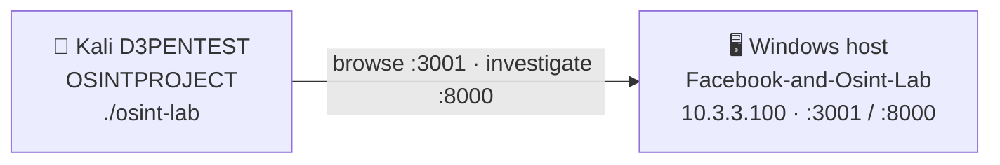

# FLOWSINT

Step-by-step flow for setting up and teaching the classroom OSINT lab.

> **CYBERSECURITY CLASSROOM SIMULATION — everything is fictional and authorized-network only.**
> Not connected to Facebook/Meta, real people, or real systems.

**Two projects work together:**

| Repo | Role | Runs on |
|---|---|---|
| [Facebook-and-Osint-Lab](https://github.com/Tsuyoiman/Facebook-and-Osint-Lab) | Fictional Facebook clone (the target) | Windows host |
| [OSINTPROJECT](https://github.com/Tsuyoiman/OSINTPROJECT) | Python OSINT client | Kali VM (**D3PENTEST**) |



---

## Setup — do these in order

### 1. Instructor: start the target (Windows)

Open PowerShell in the `Facebook-and-Osint-Lab` folder:

```powershell
npm run install:all     # first time only
npm run dev
```

Keep this window open for the whole class. The host IP is fixed at **`10.3.3.100`**.
Note the ports it prints (normally **frontend 3001**, **API 8000**) — a port only
changes if it's already in use.

### 2. (Optional) Allow the ports in Windows Firewall

**Skip this if Windows Firewall is off.** Only if it's on and other PCs can't reach
the site, run PowerShell **as Administrator**:

```powershell
New-NetFirewallRule -DisplayName "Lab Frontend" -Direction Inbound -Action Allow -Protocol TCP -LocalPort 3001 -Profile Private
New-NetFirewallRule -DisplayName "Lab API"      -Direction Inbound -Action Allow -Protocol TCP -LocalPort 8000 -Profile Private
```

### 3. Students: create and set up your account (browser)

While the server is running and **before booting Kali**, each student builds a profile
that classmates will investigate later. From a browser on the same network:

1. Open **`http://10.3.3.100:3001`** and **register a new account**.
2. Go to your **profile** → edit your **bio** and add the **profile / cover pictures**
   you want.
3. **Add classmates as friends:** type a classmate's name in the **search bar**, open
   their profile, and send a friend request. The classmate **accepts** the incoming
   request.
4. **Reload the page** to see friend-request / acceptance **notifications** — they
   don't appear until the page refreshes.

This seeds everyone as a live target, so after the Kali lab is set up students can
OSINT each other, not just the seeded accounts.

### 4. Student: set D3PENTEST network to NAT (VMware)

In **VMware → D3PENTEST → Settings → Network Adapter**, select **NAT**, then start
the VM. (NAT lets Kali reach the host at `10.3.3.100` without extra configuration.)

### 5. Student: confirm Kali can reach the host

```bash
ping -c 3 10.3.3.100
curl -i "http://10.3.3.100:8000/searchUsers?q=Megan"
```

An HTTP response = reachable. `GET /` returning `404 Cannot GET /` is **normal** — the
API has no root route, but a 404 still proves the server answered.

### 6. Student: get the OSINT client

```bash
cd ~
git clone https://github.com/Tsuyoiman/OSINTPROJECT.git
cd OSINTPROJECT      # already cloned? run: git pull
```

### 7. Student: check `config.py`

It already ships set to the static host — usually nothing to change:

```python
LAB_IP = "10.3.3.100"        # static — already set
LAB_PORT = 8000              # change only if the terminal printed another port
FRONTEND_PORT = 3001
AUTHORIZED_NETWORK = "10.3.3.0/24"   # only range option 6 may scan
```

### 8. Student: install and launch

```bash
chmod +x install.sh osint-lab
./install.sh
./osint-lab
```

If the virtualenv step fails (`ensurepip` missing), the installer automatically falls
back to `pip install --break-system-packages` — that's fine.

### 9. Test the connection

In the menu pick **`[1] Test Target Connection`** → expect `Target is reachable (HTTP 200)`.

---

## The investigation flow (the lesson)

Run the menu options in order — each feeds the next:

| Step | Option | What students do | What they learn |
|---|---|---|---|
| 1 | `[1]` Test connection | Confirm Kali reaches the API | Recon needs a reachable, in-scope target |
| 2 | `[2]` Search users | Search a clue (`Megan`, a name, an email) → get `@username` | Turning a weak clue into an identifier |
| 3 | `[3]` Investigate profile | Enter the `@username` → bio, job, city, posts, friends | How much one profile exposes |
| 4 | `[4]` Correlate friends/orgs | Pivot through the target's friends | **Core lesson:** harmless facts reveal more when linked |
| 5 | `[5]` Download images + EXIF | Save public images; read metadata | Images carry hidden data |
| 6 | `[6]` Authorized recon | Nmap the authorized target only | Services/ports — and staying in scope |
| 7 | `[7]` Generate report | Produce the 17-section report | Findings → defensible documentation |

**Starter demo:** `[2] Megan` → `@megan_fox`, then `[3] megan_fox`, `[4]`, `[5]`, `[7]`.
Seeded handles: `megan_fox`, `zendaya`, `margot_robbie`, `ana_de_armas`, `jenna_ortega`,
`scarlett_johansson`. Students can also search a **classmate's name** (from Step 3) and
investigate their account the same way.

Reports are saved to `output/report_<username>_<timestamp>.txt` on the Kali VM.

---

## Rules of engagement

Fictional lab data and the authorized network **only**. Do **not** target real people
or sites, attempt account takeover or auth bypass, read private messages, access
MongoDB directly, scan arbitrary internet addresses, or use any of this to stalk or
harass. The exercise is **reconnaissance and reporting**, not exploitation.

---

## Quick troubleshooting

| Symptom | Check |
|---|---|
| `[1]` target unavailable | Is `npm run dev` running? Does `LAB_PORT` match the printed port? (IP is fixed `10.3.3.100`) |
| Site won't load in Kali | Use `http://10.3.3.100:3001`, not `localhost`; set Firefox to **No proxy** |
| `curl` works, browser doesn't | Firefox proxy, or wrong port |
| `requirements.txt` not found | `cd ~/OSINTPROJECT` first |
| No EXIF / Nmap | `sudo apt install -y nmap libimage-exiftool-perl` (optional) |

More detail is in each source repo's own README.
